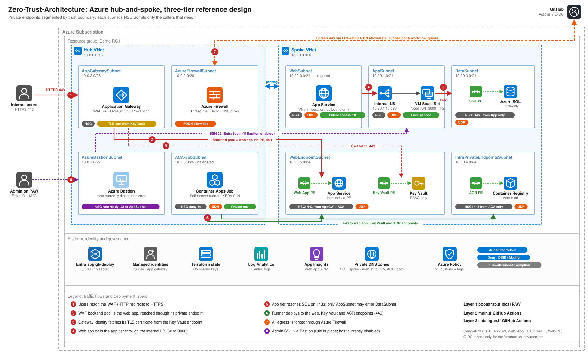

# Enterprise Azure Zero-Trust Architecture (ZTA) & Policy-as-Code Engine

**An enterprise-grade, highly secure, 3-tier application architecture (Voting Application) deployed on Microsoft Azure using Terraform, GitHub Actions, and Azure Policy-as-Code. This project implements a strict Zero-Trust (Never Trust, Always Verify) security posture, complete with identity federation, micro-segmentation, private endpoints, encryption, and continuous compliance enforcement.**


-success)


---

## Architecture



> Editable source: [`docs/architecture.drawio`](docs/architecture.drawio) (open in [diagrams.net](https://app.diagrams.net)). Numbered red/purple/green/orange flows are explained in the diagram legend.

## Table of Contents

1. [Architecture](#architecture)
2. [Project Overview](#project-overview)
3. [The Problem](#the-problem)
4. [The Solution](#the-solution)
5. [Repository Structure](#repository-structure)
6. [Design Decisions](#design-decisions)
7. [Policy Catalogue (Compliance as Code)](#policy-catalogue-compliance-as-code)
8. [Deployment Guide](#deployment-guide)
9. [Cost and Teardown](#cost-and-teardown)
10. [Known Trade-offs and Roadmap](#known-trade-offs-and-roadmap)
12. [What this project demonstrates](#what-this-project-demostrates)

---

## Project Overview
**Modern cloud architectures require security built into every layer—from code repositories and infrastructure deployment pipelines down to network routing and data storage. This project establishes a production-ready Azure environment governed by automated compliance controls. The platform is bootstrapped from a Privileged Access Workstation (PAW), after which all infrastructure changes flow through GitHub Actions running on a self-hosted, event-driven GitHub runner — no long-lived credentials anywhere, and every deployment is governed by Azure Policy as code.**

| | |
|---|---|
| **What it is** | A production-style Zero Trust reference architecture on Microsoft Azure, defined in Terraform |
| **Network model** | Hub-and-spoke, with forced tunnelling through Azure Firewall and default-deny NSGs on every tier |
| **Workload** | Three tiers: web (App Service), app (Linux VM Scale Set), data (Azure SQL), fronted by a WAF |
| **Pipeline** | GitHub Actions running on a **self-hosted, event-driven runner inside the VNet** (Azure Container Apps Job) |
| **Identity** | Workload identity federation (OIDC) for CI/CD, managed identities for runtime, Entra ID-only auth for data and admin access |
| **Governance** | A custom Azure Policy initiative (26 built-in definitions plus tag controls) assigned and managed as code |
| **Deployed in three layers** | `bootstrap` (from a Privileged Access Workstation), then `main` and `catalogue` (from CI/CD) |

---

## The Problem

Most cloud security failures are not exotic attacks. They are **ordinary misconfigurations and over-trusted components**:

1. **Flat networks** — everything can reach everything; a single compromised workload exposes the whole estate.
2. **Standing credentials** — CI/CD pipelines armed with long-lived secrets (client secrets, subscription-level `Contributor`) that are powerful and leak-prone.
3. **Over-privileged automation** — deployment identities that can do anything, including modifying their own permissions.
4. **Compliance drift** — resources deployed manually, with no enforcement that security baselines (no public SQL, WAF enabled, TLS 1.2+, NSGs everywhere) are actually met.
5  **CI/CD runners on the public internet** - To deploy to private resources, teams either open firewalls to GitHub-hosted runner IP ranges or put public endpoints back on everything.

The question this project answers: **how do you build an Azure landing zone where every packet, every identity, and every change is explicitly verified — and where the deployment pipeline itself cannot be abused to escalate privileges?**


## The Solution

This project implements Zero Trust across the three principles Microsoft defines, and delivers it through a pipeline that follows the same rules.

| Zero Trust principle | How it is implemented here |
|---|---|
| **Verify explicitly** | Entra ID-only authentication on SQL, Azure RBAC (no access policies or keys) on Key Vault and storage, OIDC federation for CI/CD locked to a GitHub *environment*, and Entra-backed SSH login on VMs |
| **Use least privilege** | A custom IaC role that **cannot touch `Microsoft.Authorization`**, a *conditioned* RBAC Administrator that can only assign six pre-approved roles to service principals, and per-resource scoped role assignments for managed identities |
| **Assume breach** | Default-deny NSGs on every subnet, all egress forced through Azure Firewall with an FQDN allow-list and threat intelligence in `Deny` mode, private endpoints for every PaaS service, a WAF in Prevention mode, and full audit logging to Log Analytics |

And because configuration drifts, **Azure Policy as Code** continuously audits or denies deviations from the baseline.

### The three-layer deployment model

```
┌────────────────────────┐   ┌─────────────────────────────┐   ┌──────────────────────────┐
│  1. ./platform         │   │  2. ./workload              │   │  3. ./policies           │
│  bootstrap.tf          │──▶│  main.tf                   │──▶│  catalogue.tf            │
│                        │   │                             │   │                          │
│  Run from a local PAW  │   │  Run by GitHub Actions on   │   │  Run by GitHub Actions   │
│                        │   │  the self-hosted runner     │   │  on the self-hosted      │
│  Creates the platform: │   │                             │   │  runner                  │
│  state, identities,    │   │  Creates the 3-tier Zero    │   │                          │
│  RBAC, hub/spoke VNets,│   │  Trust workload: firewall,  │   │  Creates the Azure       │
│  Key Vault, ACR and    │   │  WAF, Bastion, private      │   │  Policy initiative,      │
│  the CI/CD runner      │   │  endpoints, NSGs, web/app/  │   │  assignment, exemptions  │
│                        │   │  data tiers                 │   │  and logging policy      │
└────────────────────────┘   └─────────────────────────────┘   └──────────────────────────┘
   Trust anchor (human)           Automated, no secrets              Automated, no secrets
```

Why three layers? A pipeline cannot create the thing that runs the pipeline. The bootstrap layer solves that chicken-and-egg problem **once, by a human on a hardened workstation**. Everything after that is automated, auditable and secretless.

---

## Design Decisions

Each decision below lists **what** was chosen, **why**, and the **trade-off** accepted.

### 1. Bootstrap from a Privileged Access Workstation, not from CI/CD

- **What:** `bootstrap.tf` is applied once from a local, hardened PAW using the engineer's own Entra identity (`az login`).
- **Why:** The platform layer creates the identities, RBAC and runner that CI/CD depends on. It is the root of trust, so it should be created by a verified human on a hardened device, not by an automated identity that does not yet exist.
- **Trade-off:** Bootstrap uses local state initially (see [state handling](#a-note-on-bootstrap-state)) and is a manual step. It is rarely changed, so the cost is low.

### 2. A self-hosted runner inside the VNet, as an event-driven Container Apps Job

- **What:** The runner is a container image built in ACR and run as an `azurerm_container_app_job` in a delegated subnet of the hub VNet. A KEDA `github-runner` scaler polls the repository's workflow queue every 30 seconds. It scales from **0** up to `max_runners`, and each execution picks up one queued job.
- **Why:**
  - Private endpoints and `public_network_access = false` mean **GitHub-hosted runners cannot reach the targets**. Opening firewalls to GitHub's IP ranges would defeat the point.
  - Scale-to-zero means there is **no always-on build server** to patch, attack or pay for.
  - The Container Apps environment itself has public network access **disabled**, and the runner subnet has an NSG that denies all inbound traffic.
  - After `main.tf` is applied, the runner's own egress is forced through Azure Firewall and limited to the FQDN allow-list.
- **Trade-off:** More moving parts than a hosted runner (image build, registry, scaler config), in exchange for a pipeline that lives *inside* the trust boundary.

### 3. Secretless CI/CD with OIDC workload identity federation

- **What:** The `gh-deploy` app registration has **no client secret**. A federated credential trusts GitHub's OIDC issuer, and only for tokens issued to the **`production` GitHub environment** of this repository.
- **Why:** There is nothing to leak, rotate or expire. A fork, a different branch, or a workflow that does not target the protected environment cannot obtain an Azure token. Environment protection rules (required reviewers) become a real deployment gate.
- **Trade-off:** Every job that authenticates to Azure must declare `environment: production`.

### 4. A least-privilege IaC role instead of `Contributor`

- **What:** A custom role, **Enterprise IaC Deployment Role**, allows full management of only the resource providers this project uses (Compute, Network, Storage, Web, Key Vault, SQL, ACR, and so on) and explicitly lists `Microsoft.Authorization/*` in `not_actions`.
- **Why:** The pipeline can build infrastructure but **cannot grant itself or anyone else access** by default, nor modify policy or locks. This removes the classic "compromised pipeline becomes subscription owner" path.
- **Trade-off:** Adding a new Azure service means consciously extending the role. That friction is deliberate.

### 5. Delegated role assignment with an ABAC condition

- **What:** Infrastructure needs some role assignments (for example, giving a managed identity `AcrPull`). The pipeline is given **Role Based Access Control Administrator** at subscription scope, **constrained by an ABAC condition**. It may only create role assignments where the role is one of six pre-approved data-plane or runtime roles (Storage Blob Data Contributor, Key Vault Secrets User, Key Vault Crypto User, a Key Vault role, AcrPull, Monitoring Metrics Publisher) **and** the principal type is `ServicePrincipal`.
- **Why:** The pipeline can wire up service-to-service access but **cannot assign Owner, Contributor or any role to a human user**. This is delegated administration with a hard ceiling.
- **Trade-off:** The allow-list of role GUIDs must be maintained, and the condition is harder to read than a plain role name.

### 6. Terraform state with no shared keys

- **What:** State lives in a dedicated resource group and storage account with `shared_access_key_enabled = false`, `default_to_oauth_authentication = true`, TLS 1.2 minimum, no public blob access, a private container and **blob versioning** enabled. The pipeline identity gets only `Storage Blob Data Contributor` on that resource group.
- **Why:** State files contain sensitive data. With shared keys disabled, access is possible only through Entra ID and is therefore RBAC-controlled and auditable. Versioning allows recovery from a corrupted or deleted state.

### 7. Secrets in Key Vault, consumed by identity, never by value

- **What:** The GitHub PAT used by the runner scaler is stored in Key Vault (RBAC mode). The Container Apps Job references it through a **Key Vault secret reference** resolved by a user-assigned managed identity holding only `Key Vault Secrets User`. The ACR pull also uses that identity (`AcrPull`), so there is no registry password (`admin_enabled = false`).
- **Why:** No credentials appear in job definitions, and the identity can be scoped, audited and revoked independently.

### 8. Hub-and-spoke with forced tunnelling

- **What:** Shared and edge services (Firewall, Bastion, Application Gateway, runner) sit in the **hub**. Workloads sit in the **spoke**, which is split into Web, App and Data subnets plus two dedicated private-endpoint subnets (`WebEndpointSubnet`, `InfraPrivateEndpointsSubnet`). A user-defined route sends `0.0.0.0/0` from every spoke subnet and the runner subnet to Azure Firewall.
- **Why:** Egress is inspected and restricted centrally, so a compromised workload cannot freely call out to a command-and-control server. Shared services are deployed once instead of per workload.

### 9. Micro-segmentation with default-deny NSGs per tier

- **What:** Each tier and each private-endpoint subnet has its own NSG ending in an explicit `deny-all`. Allowed flows are narrow and source-specific:

  | From | To | Port | NSG |
  |---|---|---|---|
  | Internet | App Gateway | 443 / 80 (80 only redirects) | AppGW |
  | App Gateway | `WebEndpointSubnet` (web app and Key Vault endpoints) | 443 | AppGW out, Web-PE in |
  | Web app (`WebSubnet`) | Internal LB frontend `10.20.1.10` only | 80 / 8080 / 3000 | Web out |
  | Web tier | `AppSubnet` | 80 / 443 / 3000 | App in |
  | `AppSubnet` | `DataSubnet` (SQL endpoint) | 1433 | App out, DB in |
  | Runner (ACA) | `WebEndpointSubnet` and `InfraPrivateEndpointsSubnet` | 443 | Web-PE in, Infra-PE in |
  | Runner (ACA) | `AppSubnet` | 22 / 443 | App in |
  | Bastion subnet | `AppSubnet` | 22 | App in |

- **Why:** Lateral movement is blocked by default. Every subnet admits only the callers that must reach it, and nothing else.

### 10. Private endpoints segmented by who needs them (reduced blast radius)

- **What:** SQL, Key Vault, App Service and ACR each get a private endpoint, but **not in one shared subnet**. They are grouped by who is allowed to call them:
  - **`DataSubnet`** holds the SQL endpoint. Only the app tier can reach it.
  - **`WebEndpointSubnet`** holds the web app and Key Vault endpoints. The App Gateway (backend and certificate retrieval) and the runner can reach it.
  - **`InfraPrivateEndpointsSubnet`** holds the ACR endpoint. Only the runner can reach it; the App Gateway cannot.

  `privatelink.*` Private DNS zones are linked only to the VNets that need name resolution. SQL and the web app have public network access disabled.
- **Why:** A single endpoint subnet forces one NSG policy onto every service, so each caller ends up with more reach than it needs. Splitting by trust boundary means a compromised gateway cannot touch the registry or the database, and a compromised app tier cannot touch the registry or Key Vault. Data-plane traffic never crosses the public internet.
- **Trade-off:** More subnets and NSGs to maintain, in exchange for least-privilege network access.

### 10a. Web app as backend pool, internal load balancer for the API

- **What:** The gateway's backend pool is the **web app's FQDN**, resolved to its private endpoint. The web app is VNet-integrated for **outbound only** and reaches the API through a **Standard internal load balancer** at a fixed private IP; its NSG permits egress to that single address.
- **Why:** The only thing exposed behind the WAF is the web tier, and the API tier has no direct path from the gateway or from the internet. A fixed ILB frontend gives the web tier one stable, auditable destination, and enables health-probed rolling upgrades of the scale set.

### 11. Entra-only identity for data and admin access

- **What:** SQL has `azuread_authentication_only = true` (no SQL logins). VMs use the `AADSSHLoginForLinux` extension with Entra-based RBAC (`Virtual Machine Administrator Login`). Admin access is designed to flow through Azure Bastion (the host resource is currently commented out), with no public IPs and no jump box.
- **Why:** Access is tied to a verified identity with MFA and Conditional Access, is revocable in one place, and is fully logged. There are no shared local passwords.

### 12. WAF in Prevention mode with end-to-end TLS

- **What:** Application Gateway `WAF_v2` runs OWASP 3.2 managed rules in **Prevention** (blocking, not just logging). The HTTPS listener's certificate is generated in and fetched from Key Vault using a managed identity with `Key Vault Certificate User`. HTTP is permanently redirected to HTTPS, and the backend connection is HTTPS.
- **Why:** Common web attacks are stopped at the edge, and private keys never leave the vault.

### 13. Policy as Code with a built-in-first catalogue

- **What:** `catalogue.tf` builds a custom **policy initiative** from **built-in** Azure Policy definitions referenced by GUID, so Microsoft maintains the rule logic. Parameters live in a single map, the initiative is assigned at resource-group scope, and a `policy_enforce` variable switches between **audit-only** and **enforce**. The Azure Firewall subnet is covered by a documented **exemption**, since Azure Firewall subnets cannot have an NSG. Tag inheritance (`Modify`) and logging (`DeployIfNotExists`) each get their own managed identity with only the roles they need.
- **Why:** Preventive controls (`Deny`) stop bad configuration from being created. Detective controls (`Audit`) catch drift. Remediation controls fix gaps automatically. Using built-ins reduces maintenance and keeps definitions aligned with Microsoft's own guidance.
- **Trade-off:** Built-in policy GUIDs can be deprecated or versioned, so the catalogue needs periodic review.

---

## Policy Catalogue (Compliance as Code)

The initiative `"security-baseline"` bundles **26 built-in definitions** plus a tag requirement and tag inheritance for each tag in `required_tags`.

| Area | Control | Effect |
|---|---|---|
| **Governance** | Allowed locations | Deny |
| **Governance** | Require tag / inherit tag from resource group (per required tag) | Deny / Modify |
| **WAF** | WAF must be enabled; WAF must be in Prevention mode | Deny |
| **SQL** | Entra-only authentication; public network access disabled | Deny |
| **SQL** | Auditing enabled; vulnerability assessment enabled | AuditIfNotExists |
| **Key Vault** | Soft delete; purge protection; public access disabled; RBAC authorization | Deny |
| **App Service** | HTTPS only; public network access disabled | Deny |
| **App Service** | Latest TLS version; managed identity; resource logs | AuditIfNotExists |
| **Networking** | Subnets must have an NSG (Azure Firewall subnet exempted) | AuditIfNotExists |
| **VM / VMSS** | Management ports closed; NICs must not have public IPs | AuditIfNotExists / default |
| **VM / VMSS** | SSH keys required on Linux; encryption at host | AuditIfNotExists / Audit |
| **Container Registry** | Network restriction; admin user disabled | Deny |
| **Container Registry** | Private link in use | Audit |
| **Container Apps** | Public network access disabled; HTTPS only | Deny |
| **Logging (separate assignment)** | Built-in "allLogs to Log Analytics" initiative | DeployIfNotExists |

Both assignments use **system-assigned managed identities**, with the following role assignments created alongside them:

- Tag Contributor (tag inheritance)
- Monitoring Contributor (diagnostic settings)
- Log Analytics Contributor (workspace)

---

## Deployment Guide

### Prerequisites

| Requirement | Notes |
|---|---|
| Azure Subscription | An Azure Subscription with permissions to create Service Principals, Custom Roles, and Resource Groups. |
| Tooling on PAW | [Terraform](https://developer.hashicorp.com/terraform/install) 1.9+, [Azure CLI](https://learn.microsoft.com/cli/azure/install-azure-cli) (used by `az acr build`) installed locally. |
| PAW | A secure **Privileged Access Workstation (PAW)** or local environment for bootstrap deployment. |
| Github | GitHub repo with an `production` environment, and GitHub PAT (fine-grained) configured. To run a self-hosted runner, you need to create a personal access token (PAT) in GitHub. Each time a runner starts, the PAT generates a token to register the runner with GitHub. The GitHub Actions runner scale rule uses the PAT to monitor the repository's workflow queue and start runners as needed. |

- In GitHub, select your profile picture in the upper-right corner and select Settings.

- Select Developer settings.

- Under Personal access tokens, select Fine-grained tokens.

- Select Generate new token.

- In the New fine-grained personal access token screen, enter the following values:

| Setting | Value |
|---|---|
| Token name | Enter a name for your token. |
| Expiration | Select 30 days. |
| Repository access | Select `Only select repositories` and select the repository you created. |

- Enter the following values for Repository permissions:

| Setting | Value |
|---|---|
| Actions | Select Read-only. |
| Administration | Select Read and write. |
| Metadata | Select Read-only. |

- Select Generate token.
- Copy the token value and save somewhere, you will inject it as a variable when configuring the PAT   for the container app job.

### Globally unique names to change

Azure requires these to be unique worldwide, so change them before you deploy:

| Resource | Where | Current value |
|---|---|---|
| Terraform state storage account | `bootstrap.tf` | `sttfstate1unique123` |
| Key Vault | `bootstrap.tf` (and `data` blocks in `main.tf`) | `Deemo-kv213` |
| Container Registry | `bootstrap.tf` (and `data` blocks in `main.tf`) | `myghrunneracr123` |
| SQL Server | `main.tf` | `demosqlserver0978432` |
| Web App | `main.tf` | `miWebapp65748` |
| App Gateway DNS label | `main.tf` | `mydemozero-trust-app` |

### Input variables

| Variable | Used in | Purpose |
|---|---|---|
| `prefix` | bootstrap | Naming prefix for the runner identity, environment and job |
| `github_pat_token` | bootstrap | PAT stored in Key Vault for the runner scaler (**sensitive**) |
| `github_owner`, `github_repo` | bootstrap | GitHub owner and repository the runner serves |
| `github_runner_scope` | bootstrap | `repo` or `org` |
| `runner_labels` | bootstrap | Labels used in `runs-on` |
| `max_runners` | bootstrap | Maximum parallel runner executions |
| `gh_url`, `reg_token_url` | bootstrap | GitHub URL and runner registration-token API endpoint passed to the container |
| `vmss_public_key` | main | SSH public key for the VMSS admin user |
| `object_id` | main | Object ID of the Entra user or group set as SQL administrator |
| `policy_prefix` | catalogue | Naming prefix for the initiative and assignments |
| `allowed_locations` | catalogue | Permitted Azure regions |
| `required_tags` | catalogue | Tags that must exist on resources (inherited from the RG) |
| `policy_enforce` | catalogue | `true` to enforce, `false` for audit-only (`DoNotEnforce`) |


### Step 1: Bootstrap Platform Deployment (via Local PAW)

This creates the platform foundation. It is run once, by a human.
**What it creates:** resource groups (`rg-tfstate`, `Demo-RG1`); the custom IaC role and the `gh-deploy` app registration with its OIDC federated credential and role assignments; the locked-down Terraform state storage account; hub and spoke VNets with peering and subnets; Key Vault (with the PAT and diagnostics); Azure Container Registry and the runner image (built with `az acr build`); the Container Apps environment and the event-driven runner job.

```bash
#1. Clone the repository and navigate to the project directory:
git clone https://github.com/Be4rCl4w@121987346/Zero-Trust-Architecture.git
cd Zero-Trust-Architecture/terraform/platform

#2. Authenticate to Azure via CLI:
az login
az account set --subscription "<subscription-id>"

#3. Initialize and apply the bootstrap configuration:
terraform init
terraform apply -var="github_pat_token=<PATH_TO_YOUR_PAT>" 
```

#### A note on bootstrap state

Bootstrap creates the storage account that holds everyone else's state, so its first run uses local state. That state file contains the PAT value in clear text. Treat it as a secret: keep it on the PAW only, and do not commit it (add `*.tfstate*` and `*.tfvars` to `.gitignore`). Once the state storage exists you can optionally migrate it with `terraform init -migrate-state` and a `backend "azurerm"` block.

 
### Step 2: Main Infrastructure & Policy Deployment (via GitHub Actions CI/CD)

Once the bootstrap phase provisions the self-hosted container app runner, subsequent modifications to `./Workload (3-tier architecture)` and `./Policies (Policy-as-Code)` are automatically handled securely through GitHub Actions using OIDC federation without exposing permanent cloud credentials.

In the GitHub repository:

- **Settings, Environments:** create an environment named exactly production. The federated credential only trusts tokens for this environment. Add **required reviewers** for a manual approval gate.
- Add Environment Secrets `AZURE_CLIENT_ID`, `AZURE_TENANT_ID` and `AZURE_SUBSCRIPTION_ID`, `ADMIN_OBJECT_ID (your user object ID, used as the DB server admin)`, `APP_URL (URL of the App Gateway)`, `AZURE_RESOURCE_GROUP`, `AZURE_WEBAPP_NAME`, `DB_NAME`, `DB_SERVER`, `KEY_VAULT_NAME` and a `VMSS_PUBLIC_KEY` variable. These are identifiers, not credentials, since there is no client secret anywhere.

> Each of `main` and `catalogue` has a `backend.tf` that points at the storage account created in Step 1. Shared keys are disabled, so the backend must use Entra authentication

```bash
#1. Commit and push your configuration changes to the repository:
git add .
git commit -m "feat: deploy zero-trust 3-tier architecture and policies"
git push -u origin main
```

> ***Important:*** because the OIDC credential is bound to the `production` environment, every job that authenticates to Azure must declare `environment: production`, including plan-only jobs on pull requests. Add pull request pipeline to make use of the pull request OIDC credential.

> The Bastion was commented out because of my subscription public IP limit. Uncomment if your subscription limit allows more than 3 public IP.

#2. Deploy the web and API tier of the voting application
- Seed the database with tables and candidates, and also setting up the Virtual Machine Scale Set (VMSS) as a database user, via its managed identity. You can do this by temporary giving your local machine IP allow access to your DB server, then logging to the DB instance and executing the db/schema.sql file. Or for a more secure way, SSH into your VMSS and use `sql` command to connect to the DB and execute the script. With the second option you don't need to touch your network setting since the VMSS subnet is allowed to talk to the database subnet.
- On the `Actions` tab, manually deploy the web and api yaml pipelines, with the API tier first before the Web tier.
- You can as well update the runner image by triggering the `runner-image.yaml`, this helps to solve the issue of using image tag of v1, and instead use the github hash as the tag.


#### Recommended rollout order for policy

1. Deploy catalogue with policy_enforce = false (audit-only) and review the compliance dashboard.
2. Fix or exempt anything flagged.
3. Set policy_enforce = true and re-apply to turn on Deny effects.


## Cost and Teardown

This environment uses several always-billed services: Azure Firewall, Application Gateway WAF_v2, Bastion Standard, an App Service plan (P0v3), SQL (S0) and ACR. Do not leave it running unnecessarily.

```bash
#./platform (from the PAW). Note: Key Vault has soft-delete, so purge it if you plan to reuse the name
terraform destroy -var="github_pat_token=<PATH_TO_YOUR_PAT>"
```

## Known Trade-offs and Roadmap

This is a demonstration environment. These are the deliberate simplifications and the next steps for a real production rollout:

| Area | Current state | Production improvement |
|---|---|---|
| Runner authentication | GitHub PAT stored in Key Vault | Switch to a **GitHub App** (the scaler configuration is already stubbed in `bootstrap.tf`) to remove the personal token |
| TLS certificate | Self-signed certificate issued by Key Vault | Use a CA-issued or Key Vault-integrated public CA certificate |
| Key Vault network access | Public network enabled so the PAW can write the initial secret | Disable public access after bootstrap and reach the vault over the private endpoint only |


---

## What this project demonstrates

- Designing an Azure landing zone where the deployment pipeline is itself zero-trust: federated auth, ephemeral runners, and ABAC-constrained delegation mean a compromised workflow file cannot become a compromised subscription.
- Hub-and-spoke networking with forced inspection, private-by-default data planes, and tiered micro-segmentation implemented as repeatable Terraform rather than portal clicks.
- Policy-as-code that actively prevents drift (Deny) and self-heals telemetry gaps (DINE), including the judgment call of a documented exemption rather than silently skipping a control.
- Operational pragmatism: state storage bootstrapped locally then migrated, self-hosted runners that scale to zero, predictive autoscale, and centralized logging from day one.


## Author

**Okeke Chiemerie** · [LinkedIn](https://www.linkedin.com/in/chiemerie-okeke) 

*Feedback and questions are welcome. *
